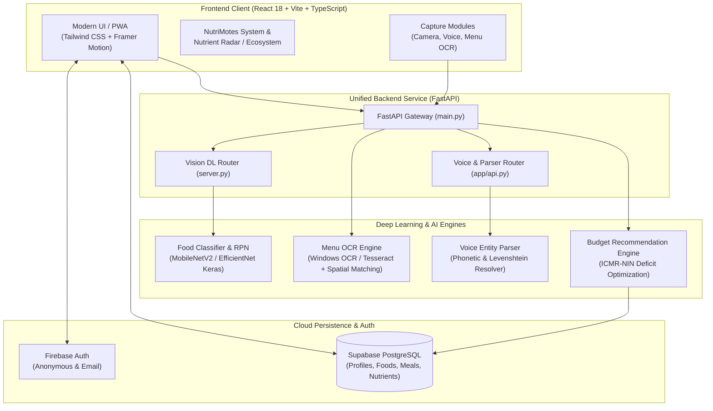
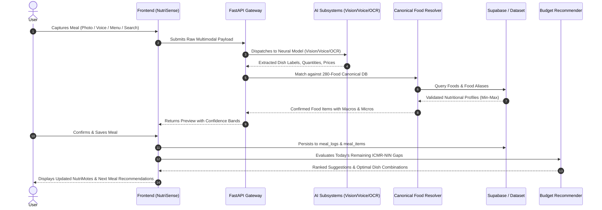

# 🥗 NutriSense — Multimodal Explainable Nutrition Intelligence Platform

[](https://react.dev/)
[](https://fastapi.tiangolo.com/)
[](https://www.tensorflow.org/)
[](https://supabase.com/)
[](https://firebase.google.com/)
[](https://www.nin.res.in/)

> *"What should I eat next, based on what I have already eaten today and my budget?"*

**NutriSense** is an end-to-end, multimodal, explainable nutrition intelligence platform engineered specifically for **Indian dietary habits**. Rooted in strict **ICMR-NIN (Indian Council of Medical Research – National Institute of Nutrition, 2024)** RDA guidelines, NutriSense removes guesswork and fake precision by combining computer vision dish detection, restaurant menu OCR, voice-driven meal parsing, real-time nutrient gap analytics, and a cost-constrained budget recommendation engine.

---

## 📑 Table of Contents
1. [Core Features](#-core-features)
2. [System Architecture](#-system-architecture)
3. [End-to-End Workflow](#-end-to-end-workflow)
4. [AI & Deep Learning Models](#-ai--deep-learning-models)
   - [1. Computer Vision & Dish Detection](#1-computer-vision--dish-detection)
   - [2. Menu OCR & Receipt Processing](#2-menu-ocr--receipt-processing)
   - [3. Voice & Speech Recognition Pipeline](#3-voice--speech-recognition-pipeline)
   - [4. Budget Recommendation Engine](#4-budget-recommendation-engine)
5. [ICMR-NIN 21 Nutrients & The NutriMotes Ecosystem](#-icmr-nin-21-nutrients--the-nutrimotes-ecosystem)
6. [Repository Structure](#-repository-structure)
7. [Installation & Setup](#-installation--setup)
8. [API Endpoints](#-api-endpoints)
9. [License](#-license)

---

## 🌟 Core Features

- 📸 **Multimodal Food Logging**:
  - **Live Camera / Dish Photo**: Recognizes complex regional Indian meals and multi-item thalis via a deep neural classifier.
  - **Restaurant Menu & Delivery Scan**: Optical Character Recognition parses physical menus or Swiggy/Zomato screenshots, extracts dish names and prices in INR (₹), and ranks dishes by your daily nutritional deficit.
  - **Bilingual Voice Logging**: Speech-to-text pipeline supporting Indian English, Hindi, and Hinglish with automatic entity extraction (dishes, portions, oil/ghee prep style).
  - **Instant Search (`Ctrl + K` / `Cmd + K`)**: Canonical database search across 280+ authentic Indian recipes with regional alias matching.
- 🎯 **No Fake Precision**:
  - Computes transparent **min-max nutrition ranges** accounting for prep variability (homemade vs. restaurant, low-oil vs. extra-ghee).
  - 3-tier confidence bands (High $>80\%$, Moderate $50\%\text{--}79\%$, Uncertain $<50\%$).
- 💰 **Budget Recommendation Engine**:
  - Recommends cost-effective foods that close your specific micro and macronutrient gaps per Rupee spent ($₹$).
  - Evaluates single dishes as well as optimal multi-dish combinations (e.g., Dal + Roti, Sattu + Chilla).
- 🧬 **Interactive 7 NutriMotes Creature System**:
  - Biological creature avatars representing core nutrients: **Protein** (hex-chain), **Iron** (faceted pebble), **Calcium** (crystal shard), **Vitamin B12** (halo orb), **Fiber** (leaf spiral), **Hydration** (water droplet), and **Energy** (pulsing ember).
- 🏆 **Gamification & Delights**:
  - Interactive ribbon-cutting unlocks for new achievements, dual-sided balloon and confetti celebrations on returning logins, and contextual meal-time reminders.

---

## 🏛 System Architecture

The NutriSense architecture unites a high-performance React Progressive Web App (PWA) with a modular FastAPI intelligence backend, Supabase PostgreSQL database, and machine learning microservices:



---

## 🔄 End-to-End Workflow



---

## 🧠 AI & Deep Learning Models

### 1. Computer Vision & Dish Detection
- **Core Classifier**: Deep Convolutional Neural Network built on a fine-tuned **MobileNetV2** backbone (`best_food_model.keras`, `finetuned_food_model.keras`).
- **Input Dimensions**: $224 \times 224 \times 3$ RGB normalized tensor.
- **Classes**: Extensive Indian culinary catalog including Dosa, Idli, Vada, Biryani, Pongal, Paneer Curries, Dal, Roti, Chana, and mixed South/North Indian specialties (`classes.json`).
- **Multi-Dish Region Proposal Network (RPN)**:
  - Custom image segmentation and contour-based proposals (`region_proposal.py`).
  - Hierarchical color-saliency and boundary extraction isolate individual bowls/katoris in a thali.
  - Non-Maximum Suppression (NMS) removes duplicate overlapping proposals with IoU threshold $\ge 0.45$.
- **Synthetic Plate Augmentation**:
  - Background blending and synthetic plate composition (`plate_synthesizer.py`) for training robustness against varying restaurant lighting and serving platters.

### 2. Menu OCR & Receipt Processing
- **Dual-OCR Hybrid**:
  - Primary: High-speed bilingual **Windows Media OCR** (`win_ocr.py`) with native Indian script and Roman character support.
  - Fallback: **Tesseract OCR** with customized layout analysis flags (`--psm 6`).
- **Spatial Price-Dish Pairing**:
  - Bounding box centroid horizontal projection algorithms align dish descriptions to price numerals on the right column.
  - Reconstructs fragmented menu lines and currency signs ($₹$, `Rs`, `/-`).
- **Menu Deficit Ranker**:
  - Scanned dishes are resolved against canonical foods and ranked in real-time according to how well each dish fulfills the user's remaining daily RDA deficit.

### 3. Voice & Speech Recognition Pipeline
- **Acoustic Speech-to-Text**:
  - Handles Indian accents, Hinglish terms, and regional pronunciation variants.
- **Rule-Guided NLP Entity Extractor** (`app/voice/voice_parser.py`):
  - Extracts numeric quantities, spoken words ("two", "ek plate", "half cup"), portion sizes, and preparation modifiers ("low oil", "without butter", "ghee roast").
- **Fuzzy Levenshtein Resolution** (`app/resolution/voice_resolver.py`):
  - Matches spoken phonetics to canonical IDs with length-weighted confidence scoring.
  - Automatically flags ambiguous inputs as `needs_verification` to ensure no incorrect food is silently logged.

### 4. Budget Recommendation Engine
- **Mathematical Optimization Function**:
  $$\text{Score}(F) = \sum_{n \in Gaps} \left( \frac{\text{NutrientContribution}(F, n)}{\text{Deficit}(n)} \times W_n \right) \div \max(\text{Price}(F), 10)$$
  where $W_n$ represents the user's priority nutrient weight.
- **Multi-Dish Combinations**:
  - Evaluates complementary pairings (e.g., Grain + Legume) to achieve complete amino acid profiles while adhering to strict price ceilings (e.g., meals under $₹100$).
- **Explainability Engine**:
  - Generates transparent, human-readable rationales: *"Provides 18g protein (36% of remaining target) for only ₹45"*.

---

## 🥗 ICMR-NIN 21 Nutrients & The NutriMotes Ecosystem

NutriSense strictly tracks **all 21 essential nutrients** defined by the **ICMR-NIN 2024 Dietary Guidelines for Indians**:

| # | Nutrient | Unit | Category | Primary Indian Dietary Sources |
|---|----------|------|----------|--------------------------------|
| 1 | **Calories** | kcal | Macro | Whole grains, millets, pulses, healthy fats |
| 2 | **Protein** | g | Macro | Dal, sprouts, paneer, sattu, eggs, fish |
| 3 | **Carbohydrates** | g | Macro | Rice, roti, millets, oats, tubers |
| 4 | **Total Fat** | g | Macro | Mustard oil, ghee, groundnut oil, nuts |
| 5 | **Dietary Fiber** | g | Macro | Green vegetables, bran, legumes, guava |
| 6 | **Iron** | mg | Micro | Spinach, drumstick leaves, methi, jaggery, chana |
| 7 | **Calcium** | mg | Micro | Curd, milk, ragi, sesame seeds, paneer |
| 8 | **Magnesium** | mg | Micro | Pumpkin seeds, bajra, almonds, dark leafy greens |
| 9 | **Potassium** | mg | Micro | Coconut water, bananas, potatoes, dal |
| 10 | **Zinc** | mg | Micro | Whole wheat, legumes, pumpkin seeds, dairy |
| 11 | **Sodium** | mg | Micro | Common salt, pickles, fermented batters |
| 12 | **Vitamin A** | mcg | Micro | Carrots, mango, papaya, drumstick leaves |
| 13 | **Vitamin C** | mg | Micro | Amla, lemon, guava, coriander, bell peppers |
| 14 | **Vitamin D** | mcg | Micro | Fortified milk, egg yolk, mushrooms, sunlight |
| 15 | **Vitamin E** | mg | Micro | Sunflower oil, peanuts, almonds |
| 16 | **Vitamin K** | mcg | Micro | Mustard greens, cabbage, methi, broccoli |
| 17 | **Vitamin B1 (Thiamin)** | mg | Micro | Unpolished rice, groundnuts, wheat germ |
| 18 | **Vitamin B2 (Riboflavin)** | mg | Micro | Curd, milk, eggs, pulses, green leafy vegetables |
| 19 | **Vitamin B6** | mg | Micro | Chickpeas, bananas, potatoes, whole grains |
| 20 | **Folate** | mcg | Micro | Bengal gram, methi, moong dal, citrus fruits |
| 21 | **Vitamin B12** | mcg | Micro | Curd, milk solids, paneer, eggs, fortified cereals |

---

## 📂 Repository Structure

```
NutriSense/
├── app/                                    # Core Python Backend & NLP
│   ├── api.py                              # FastAPI router for Voice & Nutrition
│   ├── data/                               # Canonical dataset & test media
│   │   ├── foods.csv                       # 280 Verified Indian Foods dataset
│   │   └── audio_dataset/                  # Speech validation audio files
│   ├── nutrition/                          # ICMR targets, tracker & calculators
│   ├── recommendation/                     # Nutrient gap ranking & candidate filters
│   ├── resolution/                         # Canonical food resolver (photo/voice/menu)
│   ├── schemas/                            # Pydantic validation models
│   ├── tests/                              # Pytest test suites
│   └── voice/                              # Speech-to-text & entity extraction
│
├── NutriSense/                             # Frontend Progressive Web App (PWA)
│   ├── dl_service/                         # Deep Learning Vision Microservice
│   │   ├── checkpoints/                    # Keras trained model weights (.keras)
│   │   ├── classifier.py                   # MobileNetV2 food inference engine
│   │   ├── region_proposal.py              # Thali multi-dish proposal generator
│   │   ├── server.py                       # Vision FastAPI server
│   │   └── classes.json                    # 280+ supported dish classifications
│   ├── src/
│   │   ├── components/                     # Reusable UI, NutriMotes & animations
│   │   ├── context/                        # App & Auth state management
│   │   ├── data/                           # canonical_foods.json (280 verified dishes)
│   │   ├── lib/                            # Supabase & Firebase client SDKs
│   │   ├── pages/                          # App routes (Dashboard, LogHub, Today, Reports)
│   │   └── services/                       # API services & Supabase integration
│   ├── package.json                        # Frontend npm dependencies
│   └── vite.config.ts                      # Vite build configuration
│
├── nutrisense_menu_ocr_final/              # Menu & Delivery OCR Engine
│   ├── ocr/                                # Windows Media OCR & Tesseract connectors
│   ├── pipeline/                           # Layout analysis & price pairing pipeline
│   ├── ui/                                 # Streamlit debug interface
│   └── tests/                              # OCR regression and test cases
│
├── NutriSense_Budget_Recommendation_Engine/# Budget Engine Standalone Service
│   └── budget_recommendation_service/      # Combinatorial optimization solver
│
├── main.py                                 # Unified entrypoint launching all services
├── requirements.txt                        # Global Python requirements
├── Dockerfile                              # Production Docker deployment
└── README.md                               # Project documentation
```

---

## 🚀 Installation & Setup

### Prerequisites
- **Node.js**: `v18.0.0` or higher
- **Python**: `3.10` to `3.12`
- **Git**
- Optional: Tesseract OCR (if using Tesseract fallback for OCR)

### 1. Clone the Repository
```bash
git clone https://github.com/Annie-Sherlyn/NutriSense.git
cd NutriSense
```

### 2. Backend Setup
Create a virtual environment and install backend requirements:
```bash
python -m venv venv
# On Windows:
venv\Scripts\activate
# On Linux/macOS:
source venv/bin/activate

pip install -r requirements.txt
pip install -r NutriSense/dl_service/requirements.txt
```

### 3. Frontend Setup
Install frontend dependencies:
```bash
cd NutriSense
npm install
cd ..
```

### 4. Environment Variables
Create `.env` inside `NutriSense/`:
```env
VITE_API_BASE_URL=http://localhost:8000
VITE_USE_MOCK_API=false

# Supabase Configuration
VITE_SUPABASE_URL=https://your-project.supabase.co
VITE_SUPABASE_ANON_KEY=your-supabase-anon-key

# Firebase Configuration
VITE_FIREBASE_API_KEY=your-firebase-api-key
VITE_FIREBASE_AUTH_DOMAIN=your-project.firebaseapp.com
VITE_FIREBASE_PROJECT_ID=your-project-id
VITE_FIREBASE_STORAGE_BUCKET=your-project.appspot.com
VITE_FIREBASE_MESSAGING_SENDER_ID=your-sender-id
VITE_FIREBASE_APP_ID=your-app-id
```

### 5. Running the Application

**Option A — Unified Startup**:
```bash
# Terminal 1: Launch Backend API (Vision + Voice + Recommender)
python main.py

# Terminal 2: Launch Frontend Application
cd NutriSense
npm run dev
```

Visit **`http://localhost:5173`** in your browser.

---

## 🔌 API Endpoints

| Method | Endpoint | Description |
|--------|----------|-------------|
| `GET` | `/health` | Service health status check |
| `POST` | `/predict` | Food dish classification from uploaded image |
| `POST` | `/proposals` | Multi-dish plate proposal bounding boxes |
| `POST` | `/api/voice/parse` | Natural language voice audio parsing & entity extraction |
| `POST` | `/api/recommendations` | Budget-constrained food recommendations based on nutrient gaps |
| `GET` | `/api/foods/search` | Search canonical 280 Indian dishes with nutritional ranges |

---

## 🧪 Testing

Execute test suites across subsystems:
```bash
# Python Backend & Voice Tests
pytest app/tests/

# Budget Recommendation Engine Tests
pytest NutriSense_Budget_Recommendation_Engine/budget_recommendation_service/tests/

# Menu OCR Tests
pytest nutrisense_menu_ocr_final/tests/

# Frontend Production Build Check
cd NutriSense
npm run build
```

---

## 📄 License
This project is licensed under the MIT License. Built with ❤️ for healthier Indian nutrition.
